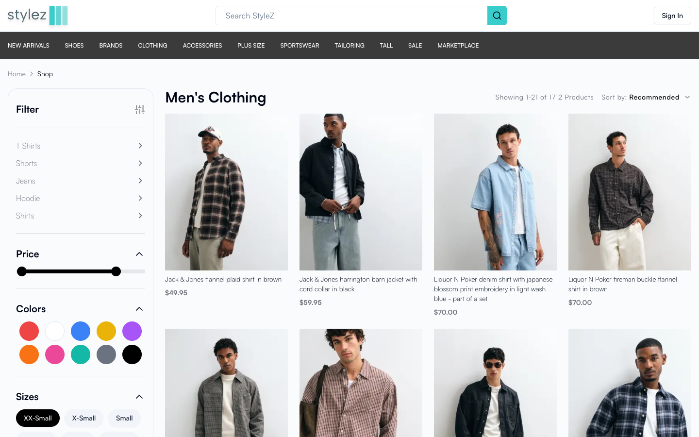

# Clothes.co

A clothing store built with Next.js 14 and Auth.js v5. It pulls a live product catalog from the ASOS API and has a full account system with email verification, password reset and two-factor sign-in.

**Live site:** https://clothes.julianzaw.me. The catalog works. Sign-in isn't set up for this address.



## Status

Not finished. Development stopped in May 2024.

| Area | State |
| --- | --- |
| Sign-up, sign-in, Google and Facebook OAuth | Done |
| Email verification, password reset, email change | Done |
| Two-factor sign-in with emailed codes | Done |
| Account settings: profile, avatar, addresses, payment methods | Done |
| Product catalog with filters and product pages | Done |
| Cart, checkout and order history | Not built. The pages are placeholders. |

## What it does

- Lists ASOS products by category through the ASOS RapidAPI, with sorting, filters and pagination.
- Registers users with a password (hashed with bcrypt) or with Google or Facebook.
- Sends verification, password-reset and two-factor emails through Resend.
- Lets a signed-in user manage name, date of birth, gender, country, phone number, avatar, saved addresses and saved payment methods, and delete the account.
- Looks up a card's bank and scheme from its BIN when the user adds a payment method.

Payment methods are a demo. Enter test card numbers only.

## Tech stack

- **App:** Next.js 14 (App Router, server actions), TypeScript, React Query
- **Auth:** Auth.js v5 (`next-auth@5`) with the Prisma adapter
- **Database:** MongoDB through Prisma
- **UI:** Tailwind CSS, shadcn/ui (Radix), NextUI, Embla carousel, Framer Motion
- **Forms:** React Hook Form with Zod
- **Email:** Resend
- **Monitoring:** Sentry

## Run it locally

You need Node.js 18 or later, a MongoDB database, a RapidAPI key with the ASOS and BIN checker APIs, and a Resend API key.

1. Install the dependencies. `postinstall` runs `prisma generate`.

   ```bash
   npm install
   ```

2. Create `.env` with these variables:

   ```bash
   DATABASE_URL=            # MongoDB connection string
   AUTH_SECRET=             # any long random string
   APP_URL=http://localhost:3000
   GOOGLE_CLIENT_ID=
   GOOGLE_CLIENT_SECRET=
   FACEBOOK_CLIENT_ID=
   FACEBOOK_CLIENT_SECRET=
   RESEND_API_KEY=
   RAPIDAPI_KEY_1=
   RAPIDAPI_KEY_3=          # fallback key, used when the first one fails
   ```

3. Push the schema and start the dev server:

   ```bash
   npx prisma db push
   npm run dev
   ```

4. Open http://localhost:3000.

## Project layout

```text
prisma/schema.prisma      User, Account, Address, Payment and token models
src/app/(home)/           Storefront, shop, cart and account settings pages
src/app/auth/             Sign-in, register, verification and reset pages
src/server/actions/       Server actions for auth, profile, addresses, payments and security
src/server/get-user-data/ Data access, including the ASOS catalog request
src/lib/auth.ts           Auth.js configuration
```
